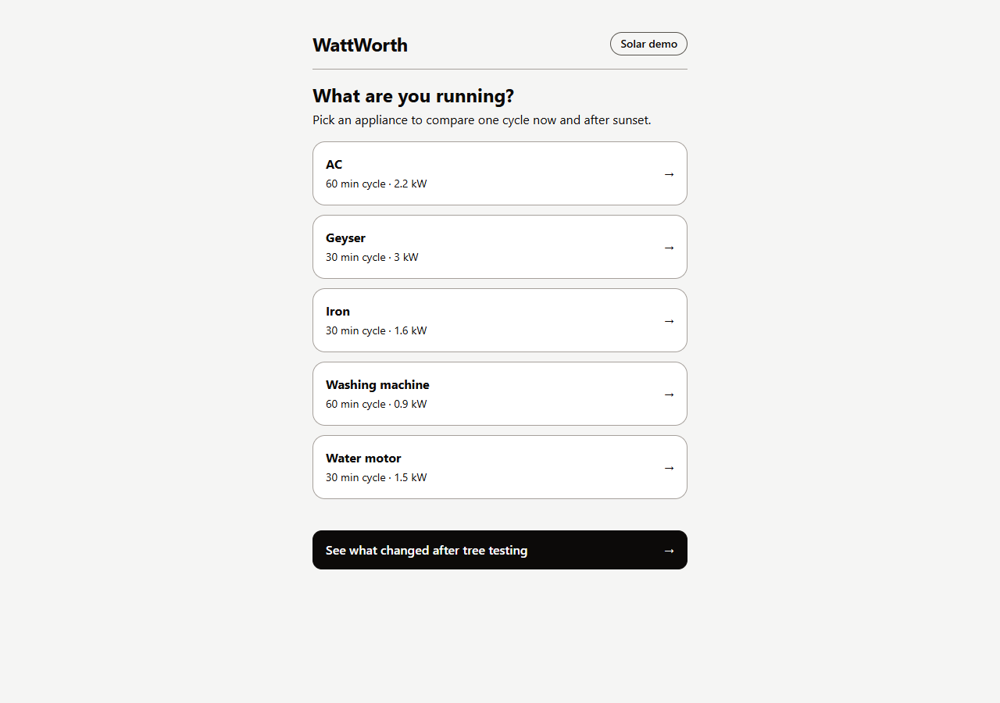
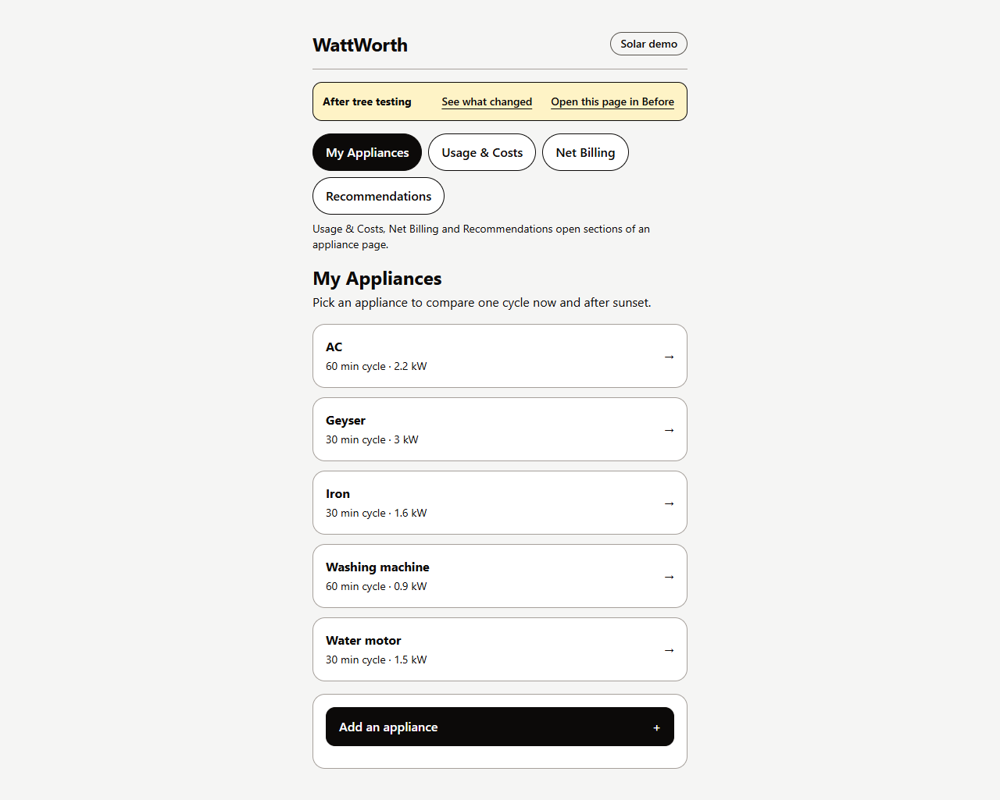

> The app now ships only the After version. The Before version now lives only at the tag `before-tree-testing`.

# Before and After tree testing

Two versions of the same app. Before is the app as it was (tag `before-tree-testing`). After is the branch `after-tree-testing`.

**2 testers per tree. Not retested. This shows what we changed and why, not proof that it improved.**

Open After by adding `?v=after` to `/` or `/cost/ac`. The page `/changes` explains both and links to each.

## What changed

| Change | Reason | Finding |
| - | - | - |
| Added a small menu: My Appliances, Usage & Costs, Net Billing, Recommendations. Only My Appliances is its own screen. The other three jump to sections of the appliance page. | The current app had no menu, only "← All appliances". Tree A, the clear menu, was the one we tested. | The current app had no menu. Tree A was the clear menu in the test. |
| Added an "Add an appliance" card and a simple form on the home page. The new item is held in local state only. | Testers could find this under My Appliances in Tree A. | T3 "add an appliance": 100% on Tree A, 0% on the generic Tree B. |
| Replaced "export credit" with "units sent back", in its own card under Net Billing. | The task said "units sent back". The app said "export credit". | T2 "units sent back to the grid": 50% even on Tree A. |
| Renamed "Best later window today" to "Best time to run" and made it the one place for time-of-day advice. Recommendations jumps to it. | Time-of-day advice was looked for in two places. | T4 "AC costs more than it should, would another time of day help": 50% on Tree A. One tester went to Recommendations and found it, the other stopped at Usage & Costs. |
| Fixed "Start the ac at ..." to "Start the AC at ...". | Wording fix. | Not from tree testing. |

## Screenshots

Desktop viewport, 1280 px wide, from a production build.

| Screen | Before | After |
| - | - | - |
| Home |  |  |
| AC page |  |  |

More: [`/changes`](before-after/05-changes.png), [AC page After with the stale reading state](before-after/06-ac-after-stale.png), [Home After with an added appliance](before-after/07-home-after-added.png).

## Checks run

- Type check (`tsc`), `next build` and `npm test` pass. There is no lint script in this repo, so lint was not run.
- In a browser: Before screens are unchanged apart from the new "See what changed after tree testing" button on the home page. Each After nav item lands on a visible, labeled section. `v=after` is kept through the plan form and the demo reading links.
- `/changes` checked at 1280 px and 390 px wide: no sideways scroll. On phones each row stacks as a card instead of a table. See [desktop](before-after/08-changes-desktop.png) and [phone](before-after/08-changes-phone.png).
- Console on `/`, `/?v=after`, `/cost/ac`, `/cost/ac?v=after` and `/changes`: no errors except a 404 for `/favicon.ico`, because the app has no favicon.

## Demo polish changes

- After AC page: added a labeled "Usage & Costs" section showing the existing solar, home use and grid draw readings. The menu item Usage & Costs jumps to it. No new data or logic.
- Menu wording: only My Appliances is its own screen. Usage & Costs, Net Billing and Recommendations open sections of the appliance page. The home menu and `/changes` now say this.
- Next.js upgraded from 16.4.4 to 16.4.6 (same minor, security patch). Build, type check and tests still pass.
