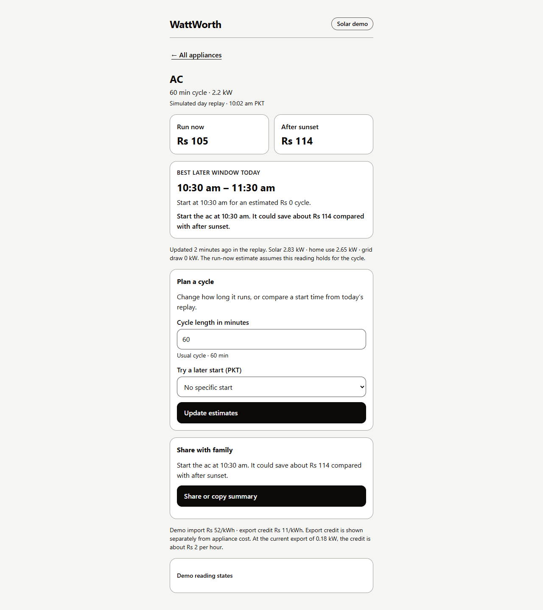
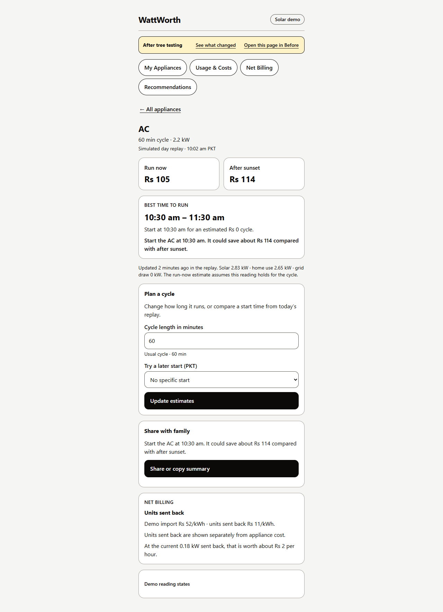

# Before and After tree testing

Two versions of the same app. Before is the app as it was (tag `before-tree-testing`). After is the branch `after-tree-testing`.

**2 testers per tree. Not retested. This shows what we changed and why, not proof that it improved.**

Open After by adding `?v=after` to `/` or `/cost/ac`. The page `/changes` explains both and links to each.

## What changed

| Change | Reason | Finding |
| - | - | - |
| Added a small menu: My Appliances, Usage & Costs, Net Billing, Recommendations. Items with no screen say "Not built in this demo". | The current app had no menu, only "← All appliances". Tree A, the clear menu, was the one we tested. | The current app had no menu. Tree A was the clear menu in the test. |
| Added an "Add an appliance" card and a simple form on the home page. The new item is held in local state only. | Testers could find this under My Appliances in Tree A. | T3 "add an appliance": 100% on Tree A, 0% on the generic Tree B. |
| Replaced "export credit" with "units sent back", in its own card under Net Billing. | The task said "units sent back". The app said "export credit". | T2 "units sent back to the grid": 50% even on Tree A. |
| Renamed "Best later window today" to "Best time to run" and made it the one place for time-of-day advice. Recommendations jumps to it. | Time-of-day advice was looked for in two places. | T4 "AC costs more than it should, would another time of day help": 50% on Tree A. One tester went to Recommendations and found it, the other stopped at Usage & Costs. |
| Fixed "Start the ac at ..." to "Start the AC at ...". | Wording fix. | Not from tree testing. |

## Screenshots

Desktop viewport, 1280 px wide, from a production build.

| Screen | Before | After |
| - | - | - |
| Home |  |  |
| AC page |  |  |

More: [`/changes`](before-after/05-changes.png), [AC page After with the stale reading state](before-after/06-ac-after-stale.png), [Home After with an added appliance](before-after/07-home-after-added.png).

## Checks run

- Type check (`tsc --noEmit`) and `next build` pass. There is no lint script in this repo, so lint was not run.
- In a browser: Before screens are unchanged apart from the new "See what changed after tree testing" button on the home page. Every After nav item scrolls to its section or shows "Not built in this demo". `v=after` is kept through the plan form and the demo reading links.
